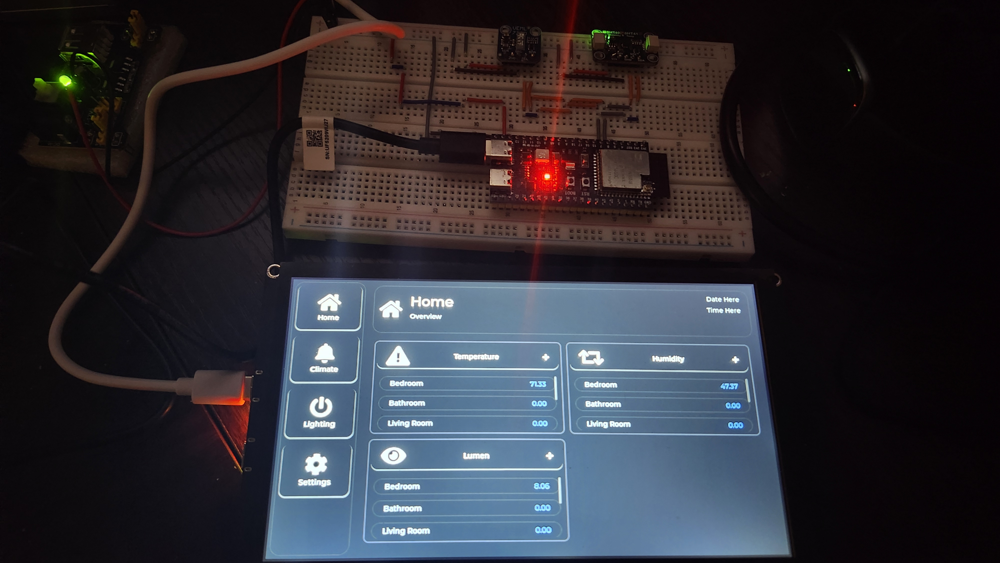
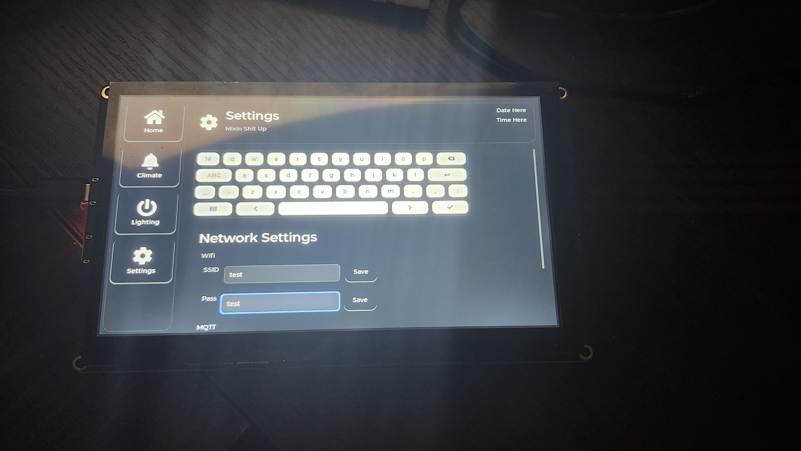

# Home HMI
### ESP32-P4 Embedded Home Automation Interface

A custom embedded home automation interface built around the ESP32-P4 microcontroller and a 7-inch 1024×600 touchscreen display. The project focuses on modular firmware architecture, real-time task management, graphical interface development, and distributed IoT communication.

The long-term goal is to develop a centralized home interface capable of monitoring environmental conditions, managing connected devices, and communicating with distributed sensor modules through MQTT.

---

## Project Overview

Home HMI is an independently developed embedded systems project using ESP-IDF and LVGL.

The firmware is structured around modular components responsible for application initialization, user interface management, networking, and data handling.

The interface uses a dynamic page architecture with reusable UI components and shared application state.

The project is being developed with maintainability and extensibility in mind, allowing additional functionality to be integrated without unnecessarily coupling individual subsystems.

## Hardware

| Component | Description |
|---|---|
| Microcontroller | ESP32-P4 |
| Display | 7-inch IPS touchscreen |
| Resolution | 1024 × 600 |
| Touch Controller | GT911 |
| Display Framework | LVGL 9.1 |

## Software Stack

- **ESP-IDF 5.5.4** – Embedded development framework.
- **C** – Primary firmware programming language.
- **FreeRTOS** – Task scheduling and synchronization.
- **LVGL 9.1** – Graphical user interface development.
- **CMake** – Build configuration and component management.
- **MQTT** – Messaging protocol for distributed IoT communication.
- **Git** – Version control.

## Firmware Architecture

The project follows a modular component-based architecture using ESP-IDF's component management system.

Major subsystems include:

### Application Initialization
Responsible for initializing hardware and application-level components.

### User Interface
Built using LVGL 9.1.

Features include:
- Dynamic page construction.
- Reusable UI components.
- Page switching and navigation.
- Shared application state.
- Touchscreen interaction.
- Dynamic data presentation.

### Networking
Responsible for network connectivity and MQTT communication.

The intended architecture supports communication between the HMI and distributed environmental sensor modules.

### Data Management
Provides a centralized approach to application data handling.

Includes:
- Shared application state.
- Data snapshots.
- Mutex-protected access to shared resources.
- Structured sensor data.

### Real-Time Operations
Uses FreeRTOS to coordinate independent application operations.

Implemented concepts include:
- Task management.
- Inter-task communication.
- Queues.
- Mutexes.
- Binary semaphores.
- Task synchronization.

## Current Development

The project is actively under development.

Current development focuses on:
- Refining firmware architecture and component separation.
- Improving code organization and maintainability.
- Expanding dynamic UI functionality.
- Developing networking and MQTT integration.
- Integrating environmental sensor data.
- Improving memory management and runtime stability.

## Planned Features

- Environmental monitoring.
- Temperature and humidity monitoring.
- Ambient light measurement.
- Distributed wireless sensor modules.
- Centralized MQTT communication.
- Home automation device controls.
- Historical sensor data storage.
- Integration with a local home server.
- Smart Lighting

## Development Environment

The project is developed using:

- Windows.
- Visual Studio Code.
- ESP-IDF 5.5.4.
- CMake.
- Git.
### Project Gallery
### Home Interface

### Settings Interface

### Building

This project uses the ESP-IDF build system.

After configuring the ESP-IDF development environment:

idf.py set-target esp32p4
idf.py build

To flash the firmware:

idf.py -p PORT flash monitor

Replace PORT with the serial port associated with your development board.

Additional hardware and component dependencies may be required depending on the project configuration.

Project Philosophy

This project is intended to be more than a functional home automation interface.

It is an opportunity to develop a deeper understanding of embedded software engineering, including firmware architecture, real-time operating systems, peripheral communication, memory management, and distributed systems.

Development prioritizes modularity, maintainability, and understanding the underlying hardware and software rather than relying on high-level abstractions.

Status: Active Development
Platform: ESP32-P4
Language: C
Framework: ESP-IDF