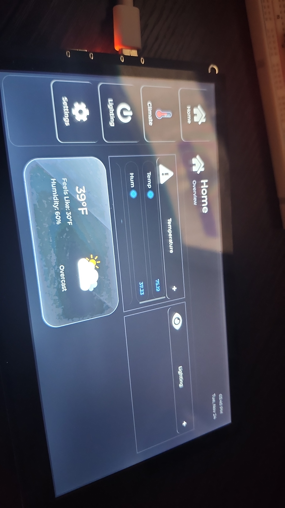
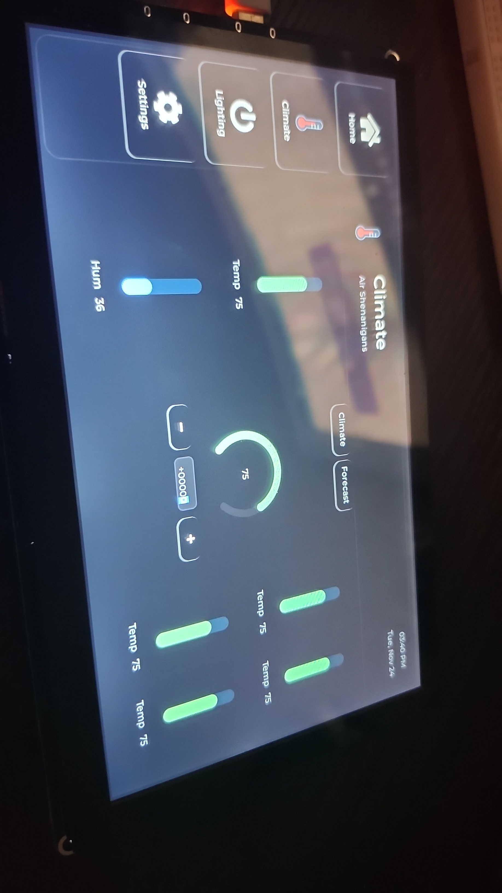
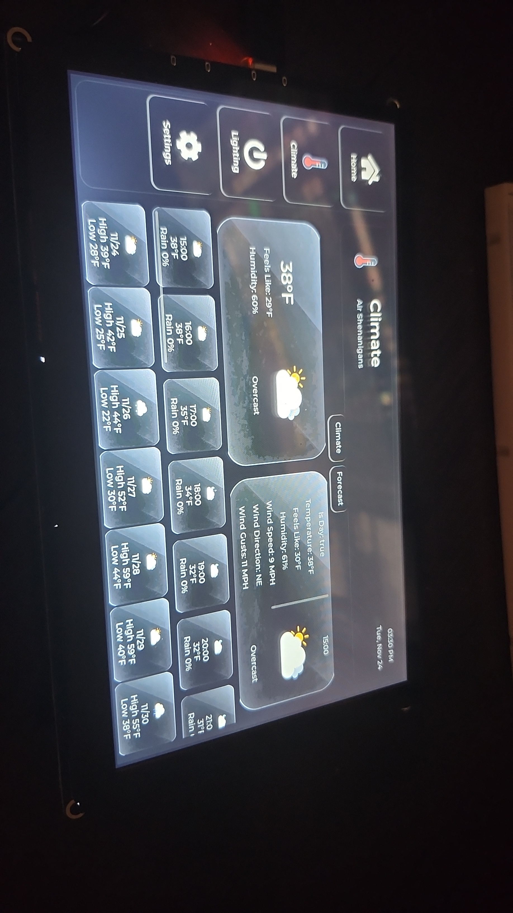
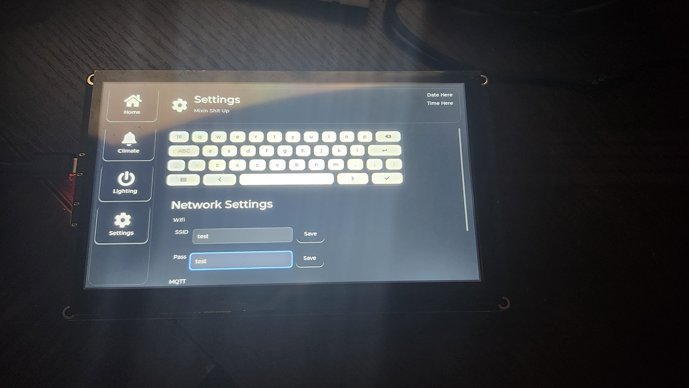

# Home HMI

A work-in-progress home monitoring and control interface for an ESP32-P4. It runs on a 7-inch, 1024 × 600 touchscreen and combines an LVGL user interface with MQTT sensor data and an online weather forecast.

The firmware is being developed as a modular ESP-IDF project. Some pages and configuration flows are still prototypes; see [Development status](#development-status) for current scope.

## Hardware and software

| Area | Details |
|---|---|
| MCU | ESP32-P4 |
| Display | 7-inch IPS touchscreen, 1024 × 600 |
| Touch controller | GT911 |
| UI | LVGL 9.1 with Espressif's LVGL port |
| Framework | ESP-IDF 5.5.4 |
| Language | C |
| Build system | CMake and the ESP-IDF build tools |
| Network | Wi-Fi station, MQTT, and HTTPS weather requests |

Use a board and display assembly compatible with the project's display, touch, power, and network configuration. Board-specific setup is in `peripheral/` and `sdkconfig.defaults`.

## Current functionality

- Touch navigation between Home, Climate, Lighting, and Settings pages.
- Home dashboard with weather, climate, and lighting cards.
- Climate page with a toggle between sensor readings and weather forecasts.
- Current conditions and forecast data fetched from [Open-Meteo](https://open-meteo.com/).
- Hourly forecast cards with time, condition icon, temperature, and precipitation chance; the hourly row scrolls horizontally.
- Daily forecast cards with date, condition icon, and high/low temperatures.
- MQTT input for SHT41 temperature/humidity and VEML7700 ambient-light sensor data.
- FreeRTOS tasks, queues, and shared data snapshots to pass sensor and weather updates to the UI.

The Lighting page and some settings flows are still under development; their presence in the navigation does not imply that device controls or persistent settings are complete.

## Data flow

```text
SHT41 / VEML7700
        │ MQTT
        ▼
 MQTT manager ──► message queue ──► data task ──► shared snapshot ──► LVGL pages

 Open-Meteo ──HTTPS──► weather manager ──► weather queue ──► data task
```

The MQTT client subscribes to these topics:

| Topic | Expected JSON fields |
|---|---|
| `home/sensor/sht41/data` | `temp`, `hum` |
| `home/sensor/sht41/state` | `state` |
| `home/sensor/veml7700/data` | `lux` |
| `home/sensor/veml7700/state` | `state` |

Weather is configured for current conditions and hourly and daily forecasts. The refresh interval is 30 minutes. The weather task currently waits for that interval before its first request, so forecast data may not appear immediately after boot.

## Project layout

| Path | Purpose |
|---|---|
| `main/` | Application entry point and hardware/system initialization |
| `peripheral/` | Display, I2C, backlight, GPIO, and board-support code |
| `ui/` | LVGL pages, reusable components, styles, and event handlers |
| `network/` | Wi-Fi station and MQTT client |
| `weather/` | Open-Meteo HTTPS client and weather-data parsing |
| `data/` | Shared application state, queues, snapshots, and sensor handlers |
| `util/` | Shared data types and utilities |
| `assets/` | LVGL image and background assets |
| `managed_components/` | ESP-IDF Component Manager dependencies |

## Configure for your device

Before building for your network:

1. Configure Wi-Fi credentials. The current prototype defines them in [`network/wifi_manager.c`](./network/wifi_manager.c). **Do not commit real credentials.** Move credentials to a private configuration mechanism such as Kconfig or NVS, and remove password logging before sharing or deploying the firmware.
2. Set the MQTT broker URI in [`main/system_init.c`](./main/system_init.c). The broker must be reachable from the device's network.
3. Set the forecast location and requested variables in [`weather/weather_manager.c`](./weather/weather_manager.c). Open-Meteo is accessed over HTTPS; the current request does not require an API key.
4. Confirm the board-specific display, touch, and network settings in `peripheral/` and `sdkconfig.defaults`.

The current Wi-Fi initialization waits for a successful connection before starting the application tasks. If the device appears to stall during startup, check its Wi-Fi configuration and the serial log.

## Build, flash, and monitor

Install ESP-IDF **v5.5.4** and its ESP32-P4 toolchain, then open a terminal where the ESP-IDF environment is active. From the repository root:

```sh
idf.py set-target esp32p4
idf.py build
```

To flash and open the serial monitor, replace `COMx` with the board's serial port:

```sh
idf.py -p COMx flash monitor
```

On Linux or macOS, use the appropriate serial device (for example, `/dev/ttyUSB0`) instead of `COMx`. The ESP-IDF Component Manager uses `main/idf_component.yml` to resolve project dependencies during configuration.

## Screenshots

### Home


### Climate


### Forecast


### Settings


## Development status

This is an active personal project. The display, touch interface, page navigation, weather retrieval, and MQTT sensor-data path are present. Lighting controls, robust user-managed network configuration, and longer-term data storage are areas for further development.

## Troubleshooting

- **Startup waits after power-on:** Wi-Fi initialization waits for a connection. Confirm the configured network is available and inspect the serial monitor.
- **Sensor values are missing:** Verify the MQTT broker is reachable and that the devices publish to the topics and JSON fields listed above.
- **Build cannot find a dependency:** Run the build from an ESP-IDF 5.5.4 environment and allow Component Manager to resolve the manifest dependencies.
